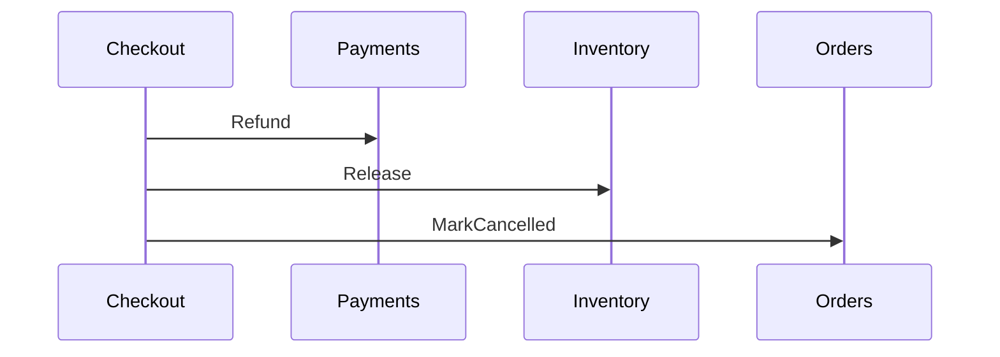
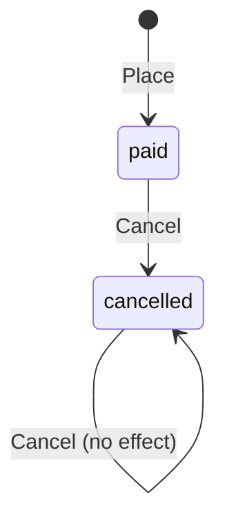

# Views

A view shows structure in the chat; the code stays in the project files. Pick
the smallest view that makes the point clear, and put it next to the one or
two sentences it supports. Keep only the files, calls, types, and errors that
the user needs for the current decision or confirmation.

## The views

A shallow **file tree** shows which files exist and what each one owns. Mark
`+` new and `~` changed:

```text
shop/
├── ~ checkout.go                # Cancel and its boundaries
├── + cancel.go                  # internal steps of Cancel
├── ~ orders.go                  # Order.Status, ErrNotCancellable
└── migrations/
    └── + 0007_cancel.sql        # orders.cancelled_at
```

A **call tree** shows which steps an operation calls, in order. Put the error
or the boundary next to the step that uses it:

```text
Checkout.Cancel(ctx, OrderID) error
  loadOrder          → ErrOrderNotFound
  checkCancellable   → ErrNotCancellable
  compensate         → Payments.Refund, Inventory.Release
  markCancelled
```

**Pseudocode** shows the logic of one body, in domain terms:

```text
Cancel(order)
  if order is shipped
    return ErrNotCancellable
  refund the payment
  release the stock
  mark the order cancelled
```

A **Mermaid diagram** shows what a tree cannot. Use a sequence diagram when
three or more participants exchange calls and their order matters. Use a state
diagram when the decision is about the states of a model and the allowed
transitions. For one caller and its steps, the call tree is smaller.





A **diff** shows a change to a shape that already exists. Use the diff of the
view that fits: the file tree, the call tree, a signature, or pseudocode.

```diff
 Checkout.Cancel(ctx, OrderID) error
   loadOrder
+  checkCancellable   → ErrNotCancellable
   compensate
-  markCancelled
+  markCancelled      → ErrConflict
```

```diff
-func (c *Checkout) Cancel(ctx context.Context, id OrderID) error
+func (c *Checkout) Cancel(ctx context.Context, id OrderID, reason CancelReason) error
```

Show the whole block when most of it is new.

## Contract map

The contract map of a phase is a file tree, then one call tree for each public
operation, then one line of checks and comment style. In the facade phase the
call tree has no steps yet: show the signature, its errors, and its boundaries.

Facade phase:

```text
shop/
├── ~ checkout.go                # Cancel, Payments, Inventory
├── ~ orders.go                  # Order.Status, Order.CancelledAt, ErrNotCancellable
├── ~ shop_test.go               # 5 Cancel scenarios
├── migrations/
│   └── + 0007_cancel.sql        # orders.cancelled_at
└── cmd/shop/
    └── ~ main.go                # passes Payments and Inventory to Checkout

Checkout.Cancel(ctx, OrderID) error
  errors:     ErrOrderNotFound, ErrNotCancellable
  boundaries: Payments.Refund, Inventory.Release

Checks: build, vet, test pass; 5 tests skipped as pending.
Comments: ASD-STE100, given-new flow.
```

Internals phase: the same map, with the steps under each operation as in the
call tree above.
